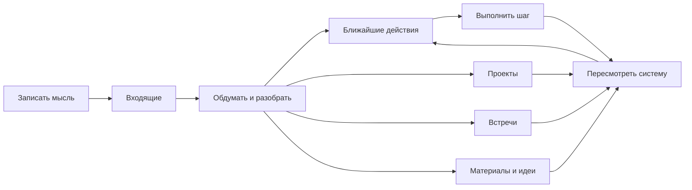

# Описание приложения «Ясный шаг»

## Назначение

Личное пространство, в котором человек быстро сохраняет мысли, превращает их в понятные действия, ведёт проекты и регулярно освобождается от неактуальных обязательств. Компьютер удобен для обдумывания и обзоров; телефон — для записи и выбора действия в текущей ситуации.

Основная ценность: открыть приложение и за несколько секунд понять, что можно сделать дальше, не восстанавливая весь контекст в голове. Это проверяемая UX-гипотеза, не обещание результата каждому пользователю.

## Для кого

Для одного человека с несколькими рабочими и личными направлениями. Он получает задачи из разговоров, сообщений и собственных мыслей, держит слишком многое в памяти, иногда переносит одинаковые пункты неделями. Ему нужны доступность данных, ясность и спокойное возвращение после перерыва.

В первой версии нет рабочих пространств команды, ролей менеджера, назначения задач другим аккаунтам, общего чата, табелей и контроля сотрудников. «Жду от Анны» — личная запись о договорённости, а не выдача Анне доступа.

## Основной цикл

## Информационная архитектура

- **Сейчас** — небольшой выбранный список. Отдельно показаны встречи и реальные приближающиеся сроки. Остатки вчерашнего выбора доступны для пересмотра, не выдаются за сегодняшний план.
- **Действия** — единый список с горизонтами «Сейчас», «Неделя», «Позже». Проекты служат контекстом, а не вложенными папками задач.
- **Входящие** — очередь ещё не обдуманного и мастер разбора.
- **Проекты** — желаемые результаты, смысл, ближайшие шаги и справочный план.
- **Обзор** — ежедневный и еженедельный ритуал, место возвращения после перерыва.
- **Ещё** — календарь, ожидания, идеи, материалы, завершённое, настройки и данные.

На компьютере разделы видны в боковой панели. На телефоне в нижней навигации: «Сейчас», «Входящие», «Обзор», «Ещё». «Записать» доступно на всех основных экранах. Проекты не прячутся глубже одного перехода через «Ещё».

## Ключевые истории

1. **Мысль в дороге.** Открыть быстрый ввод, записать «поговорить про отпуск», сохранить без даты и проекта. В офлайне получить честное подтверждение «Сохранено на устройстве».
2. **Разбор вечером.** Выделить из записи проект, действие, встречу и ссылку; проверить результаты; завершить разбор одним действием. Исходник остаётся доступен.
3. **Начало рабочего отрезка.** Открыть «Сейчас», выбрать понятный пункт; открыть фокус. Записать отвлечение во входящие, продолжить текущую работу.
4. **Непонятный проект.** Записать полезный результат и простой шаг на получение недостающей информации. Полный план не требуется.
5. **Контроль договорённости.** После отправленного запроса сохранить, кого и о чём ждём, выбрать день проверки. Когда он наступит, ожидание появится в обзоре; при необходимости создать действие «Написать … и уточнить …».
6. **Повторный перенос.** В ежедневном обзоре увидеть старую формулировку и выбрать: переписать, вернуть в неделю, отложить, отменить. Оставить без изменений тоже можно, но только явно.
7. **Отпуск или завал.** После возвращения пройти короткий обзор без накопленного «долга» по пропущенным ритуалам.
8. **Потеря телефона.** Войти на другом устройстве и восстановить серверные данные; отдельно импортировать резервную копию при необходимости. Несинхронизированные локальные изменения недоступны на другом устройстве — это должно быть видно заранее.

## Состав первой пригодной к использованию версии

| Область | Входит в MVP | Оставляем на последующие версии |
|---|---|---|
| Захват | Текст, необязательная ссылка, локальное сохранение, единый инбокс | Голосовая расшифровка, расширение браузера, приём из мессенджеров |
| Разбор | Несколько результатов из одного входящего; проект, действие, событие, материал, идея; осознанное удаление | Автоматическое извлечение ИИ |
| Действия | Редактирование, порядок, горизонты, реальный срок, выполнение, отмена | Сложные зависимости, приоритетные баллы, подзадачи-деревья |
| Проекты | Результат, смысл, минимально полезный результат, план-заметка, действия, пауза и завершение | Гант, ресурсы, бюджетирование |
| Время | Календарный список событий, текущая дата и часовой пояс, необязательная фокус-сессия | Автоматическое расписание, внешний календарный sync, фоновые push |
| Обзоры | Ежедневный и еженедельный шаблоны, сохранение прогресса, решение о хвостах, следующее появление | Конструктор сложных ритуалов |
| Ожидания | Контакт текстом, ожидаемый результат, дата проверки, создание действия контроля | Контакты устройства, автоматическая отправка напоминаний людям |
| Идеи и материалы | Текст, URL, контекст, пересмотр, превращение идеи в проект | Файловое хранилище, OCR, трёхуровневая инкубация |
| Надёжность | Аккаунт, offline-first, синхронизация, видимые конфликты, экспорт/импорт JSON, корзина | Совместное редактирование, сквозное шифрование, общий доступ |

Синхронизация входит в MVP, потому что пользователь выбрал два типа устройств. Прототип её не имитирует. Предлагаемый минимум хранения материалов — текст и ссылки; вложения не нужны для проверки основной ценности.

## Что делает продукт отличимым

Разбор — отдельная работа, а не форма добавления задачи. У проекта есть результат и ближайший шаг, а полный план не засоряет очередь. Обзор имеет такое же значение, как список действий. Отказ от ненужного считается нормальным исходом. Дата «хочу заняться» отделена от реального срока. Интерфейс помогает вернуться после перерыва без наказания.

## Знакомство

Три необязательных шага: записать одну мысль; разобрать её в понятное действие; выбрать удобный день еженедельного обзора. Можно пропустить обучение. Демо-примеры включаются явно и удаляются отдельно от реальных данных. Не требовать завести все проекты и рассортировать архив в первый день.

## Оценка пользы

На первой неделе проверить, может ли пользователь записать мысль без дополнительных решений, найти следующий шаг и понять судьбу обработанного входящего. Через две недели спросить, приходится ли ему повторно держать обязательства в голове и удобно ли возвращаться после пропуска.

Внутри приложения уместны дата последнего обзора, число необработанных записей в инбоксе и проекты без шага. Они нужны для обслуживания системы, а не для рейтинга. Не строить «индекс эффективности» по галочкам, длительности фокуса или ежедневным входам. Телеметрия текстов задач и скрытый сбор поведения не нужны.

## Дизайн

Метафора — рабочая поверхность, на которой оставлен один понятный следующий шаг. Светлый холодный фон, глубокий синий текст, спокойный синий акцент. Структура через отступы и строки списка; дополнительные сведения доступны по запросу.

Палитра: фон `#F3F6FA`, поверхность `#FFFFFF`, текст `#172B45`, основной акцент `#235CB9`, вспомогательная поверхность `#E8EFF9`, предупреждение `#805319`. Типографика: Segoe UI на Windows и системный sans-serif на других устройствах. Заголовок 32–40 px на компьютере, 28–32 px на телефоне; основной текст 16 px, пояснение 14 px. Содержание выровнено влево, комфортная ширина чтения до 70–80 символов.

Характерный элемент — крупная строка следующего действия с простым началом работы. Никаких панелей KPI, декоративных диаграмм или игровых персонажей. Цветом обозначается состояние вместе с текстом; он не является единственным носителем смысла.

## Решения, которые можно изменить перед разработкой

Рабочее название, способ размещения сервера и поставщик входа пока не утверждены. Базовое предложение — адаптивная PWA и отдельный сервер для синхронизации; отдельное нативное приложение не требуется для первого релиза. Эти вопросы не мешают создать доменную модель и основной локальный сценарий. Публичный запуск и выбор платных услуг требуют отдельного решения владельца.
